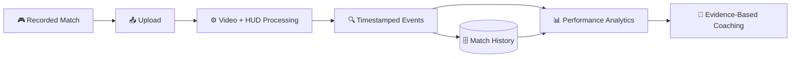
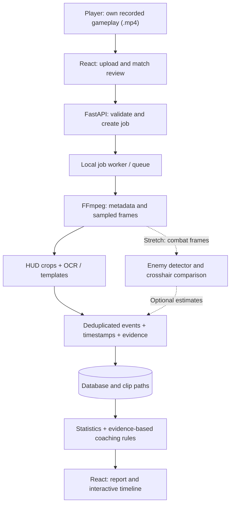

<div align="center">

# 🎯 V-INSIGHT

### See the match. Understand the mistakes. Level up.

**AI-Powered VALORANT Gameplay Analysis & Personalized Coaching**

*A final-year Computer Science project bringing computer vision, measurable gameplay insights, and actionable post-match feedback together.*

<br />


<br />

**[Explore Features](#-feature-showcase) · [Architecture](#7-architecture-and-processing-flow) · [Quick Start](#13-local-environment-setup) · [Roadmap](#14-12-week-implementation-roadmap) · [Research](#10-machine-learning-methodology)**

</div>

---

> [!IMPORTANT]
> **Project blueprint — not a released app.** Features, demo screens and API endpoints in this document are **planned**, not currently shipped. The objective is a reproducible, evidence-driven **post-match** analysis system, not a live cheat or in-game assistant.

## ✨ The Vision

**Most stat trackers tell you *what* happened. V-Insight aims to show *where*, *when*, and *why a recommendation was made*.** Upload a permitted recording, extract verifiable in-game events, inspect their timestamps and screenshots, and get training suggestions tied to actual evidence.

<div align="center">

| 🎬 RECORD | 🧠 ANALYZE | 📈 UNDERSTAND | 🎯 IMPROVE |
|:---:|:---:|:---:|:---:|
| Upload a match | Detect visible events | Explore a match timeline | Review grounded coaching tips |

</div>

## 🚀 Feature Showcase

| Module | What it does | Stage |
|:---|:---|:---:|
| 🎥 **Video intake** | Validate and queue user-provided gameplay recordings | 🔲 Planned MVP |
| 👁️ **HUD event extraction** | Use sampled frames, templates and OCR to detect selected events | 🔲 Planned MVP |
| 🕒 **Evidence timeline** | Link events to timestamps, confidence scores and proof frames | 🔲 Planned MVP |
| 📊 **Match analytics** | Calculate only metrics supported by observed data | 🔲 Planned MVP |
| 🧩 **Explainable coaching** | Attach each improvement suggestion to measured evidence | 🔲 Planned MVP |
| 🎯 **Crosshair analysis** | Estimate crosshair-to-visible-target distance | 🧪 Stretch |
| 🗺️ **Position heatmaps** | Explore richer spatial analysis if suitable data becomes available | 💡 Future |

### ⚡ At a glance

<div align="center">

| 🖥️ Desktop | 💻 Laptop | ☁️ Training |
|:---|:---|:---|
| Ryzen 5 2600 · RX 470 **8GB** · 16GB DDR4 | i5 11th Gen · Iris Xe · 16GB DDR4 | Colab / supported cloud GPU when needed |
| Video processing & CPU inference | React, API, database & demos | Optional model fine-tuning |

</div>

> [!NOTE]
> The RX 470's **8GB VRAM does not imply supported ROCm/PyTorch acceleration**. Baseline local inference should work on CPU; treat alternative AMD acceleration as experimental, and plan cloud GPU access for heavier training.

## 🧭 Project Map



<details>
<summary><strong>📚 Table of contents — explore the full technical blueprint</strong></summary>

1. [Project summary](#1-project-summary)
2. [Problem statement and objectives](#2-problem-statement-and-objectives)
3. [Scope and deliverables](#3-scope-and-deliverables)
4. [Hardware and recommended workload split](#4-hardware-and-recommended-workload-split)
5. [Software and hardware requirements](#5-software-and-hardware-requirements)
6. [Proposed tech stack](#6-proposed-tech-stack)
7. [Architecture and processing flow](#7-architecture-and-processing-flow)
8. [Features and acceptance criteria](#8-features-and-acceptance-criteria)
9. [Data collection and labeling](#9-data-collection-and-labeling)
10. [Machine-learning methodology](#10-machine-learning-methodology)
11. [Database design and API plan](#11-database-design-and-api-plan)
12. [Suggested repository structure](#12-suggested-repository-structure)
13. [Local environment setup](#13-local-environment-setup)
14. [12-week implementation roadmap](#14-12-week-implementation-roadmap)
15. [Testing and evaluation](#15-testing-and-evaluation)
16. [Risks and fallback plan](#16-risks-and-fallback-plan)
17. [Privacy, game policy and licensing](#17-privacy-game-policy-and-licensing)
18. [FYP documentation and viva checklist](#18-fyp-documentation-and-viva-checklist)
19. [Immediate next actions](#19-immediate-next-actions)
20. [References](#20-references)

</details>

---

## 🛠️ Technical Blueprint

*The sections below contain the research assumptions, deliverables, commands, architecture, quality gates and semester plan in full.*

## 🎓 1. Project summary

**Working title:** V-Insight: AI-Powered VALORANT Gameplay Analysis and Personalized Performance Coaching System.

**Concept:** A post-match web application where a player uploads their **own recorded gameplay**, the system detects a limited set of visible gameplay events, displays a match timeline and analytics, and generates evidence-based practice recommendations. The focus is on **retrospective coaching**, not live or in-game assistance.

**Target user:** Students and amateur FPS players who want specific, reviewable feedback instead of only raw match statistics.

**Core differentiator:** Each generated coaching insight should link back to **an observable event, timestamp, or measured metric**. The app should show `Unavailable` when video does not provide reliable evidence for a metric.

**Short abstract (for proposal):**

> This project proposes a computer-vision-assisted platform for analyzing recorded VALORANT matches and generating personalized player feedback. The system processes uploaded gameplay videos to extract selected visual HUD events and, in an advanced module, locate visible opponents relative to the crosshair. A web dashboard presents event timelines, summary statistics, and recommendations tied to measurable evidence. The detection pipeline will be evaluated against manually annotated gameplay using precision, recall, F1, and other relevant metrics. The prototype aims to demonstrate an explainable, practical post-match coaching workflow without requiring live game telemetry.

### Success definition

**MVP / required:** Upload video → process it offline → extract selected visible kill/death events → show timestamped timeline and computed statistics → generate grounded coaching tips → evaluate event detection on unseen footage.

**Stretch goal:** Train a small model to detect visible enemy characters and estimate crosshair-to-target positioning on selected combat frames.

**Out of scope:** Live overlays, real-time tactical directions, anti-cheat bypasses, memory reading, injection, guaranteed detection of hidden events, complete map-coordinate reconstruction, and automatic diagnosis of every player mistake.

---

## 🧠 2. Problem statement and objectives

### Problem

Traditional stat trackers summarize match outcomes but often fail to show actionable evidence from a player's actual gameplay. Full video review takes time, and extracting reliable measurements from game footage is technically challenging.

### Objectives

- Build a browser-based interface for uploading and reviewing recorded matches.
- Develop a repeatable computer vision / OCR pipeline for **selected visible** HUD events.
- Save events with timestamps, evidence frames, and detection confidence.
- Create an explainable recommendation engine that avoids unsupported claims.
- Optionally analyze crosshair proximity to visible enemies in selected frames.
- Evaluate recognition accuracy, processing speed, and usefulness of recommendations.

### Proposed research questions

1. How accurately can selected self-kill/death indicators be extracted from recorded match footage using HUD templates and OCR?
2. How does a simple baseline compare with a learned visual event detector on **unseen matches**?
3. Can measurable events be translated into recommendations that human reviewers judge factual and useful?
4. **Stretch:** How accurately can target/crosshair alignment be estimated from combat frames?

### Project hypothesis (to test, not assume)

A constrained, HUD-focused detection pipeline can identify selected gameplay events at useful precision/recall, and evidence-linked feedback will be more verifiable than generic advice.

---

## 🎯 3. Scope and deliverables

### Minimum viable product (MVP)

- [ ] User can upload an MP4 video (single-player point of view).
- [ ] Backend validates file type, duration, size, and supported resolution.
- [ ] Server performs asynchronous/background **within the running application** processing jobs; users can see progress. (This is an app feature you will implement, not a promise that it already exists.)
- [ ] Extracts frames and crops specified HUD areas.
- [ ] Detects a **limited set** of player-relevant kills and deaths, with timestamps and supporting screenshots.
- [ ] Deduplicates events across neighboring frames.
- [ ] Computes only statistics that detected observations support.
- [ ] Shows a match timeline, review cards, and a statistics dashboard.
- [ ] Generates rule-based coaching tips backed by observed events.
- [ ] Provides error messages for unsupported/corrupted uploads.
- [ ] Evaluated against a labeled held-out test set.

### Stretch goals — attempt only after MVP works

- [ ] Visible enemy detection using a small YOLO model.
- [ ] Crosshair-to-target offset when crosshair and enemy position are clearly visible.
- [ ] Clip extraction around detected events.
- [ ] Compare multiple matches and practice trends.
- [ ] Human-review feedback buttons for wrong detections.
- [ ] Optional text-generation layer that **only** verbalizes stored evidence (no invented stats).

### Non-goals

- Automatic win-rate / true headshot percentage from video unless those values are actually observable and verifiable.
- Exact reaction-time measurement without a defensible event definition and timing validation.
- Full 3D understanding, invisible enemies, or inferred complete game state.
- Riot account linking or Riot API integration for the MVP.

---

## 🖥️ 4. Hardware and recommended workload split

| System | Known hardware | Best responsibilities |
|---|---|---|
| **Desktop PC** | AMD Ryzen 5 2600; Radeon RX 470 **8 GB VRAM**; **16 GB DDR4 RAM** | Gameplay capture, FFmpeg/OpenCV processing, OCR experiments, dataset preparation, CPU inference |
| **Laptop** | Intel Core i5 **11th Gen**; Intel Iris Xe; **16 GB DDR4 RAM** | VS Code, frontend/backend development, SQLite/PostgreSQL, API testing, presentation/demo |
| **Optional cloud** | Colab or a similar hosted GPU environment | Fine-tuning a small object detector when CPU training is too slow |

**GPU compatibility caution:** The RX 470 is **not on AMD's officially supported current ROCm GPU lists**. Its 8 GB VRAM does not mean current PyTorch training will run on it. Build a CPU-first system; treat GPU acceleration via alternative backends as experimental, and use cloud resources only where needed. Intel Iris Xe is also not a substitute for an NVIDIA CUDA GPU in standard training instructions.

**Practical disk planning (estimates, not strict requirements):** Aim for **50–100 GB free storage** on the desktop if collecting multiple gameplay recordings, frames, model checkpoints, and exports. Store only sampled frames and selected clips rather than duplicating every decoded frame. An SSD is recommended. Actual needs depend on video bitrate and match count.

**Coordinate between systems:** Commit source to Git; synchronize sanitized annotation metadata; do **not** commit raw videos, large checkpoints, passwords, or private gameplay recordings.

---

## ⚙️ 5. Software and hardware requirements

### Required tools

| Tool | Purpose | Notes |
|---|---|---|
| Windows 10/11 or a compatible desktop OS | Development | Steps below use PowerShell; translate commands for macOS/Linux |
| Python **3.11** | CV and backend | Sensible starting version; confirm package support before freezing versions |
| Node.js current **LTS** | Frontend tooling | Check [Node releases](https://nodejs.org/) |
| Git | Version control | Use GitHub or another Git remote |
| VS Code | Development IDE | Optional but convenient |
| FFmpeg + ffprobe | Video metadata/frame extraction | Add to system PATH |
| OpenCV + NumPy | Image processing | CPU baseline |
| FastAPI + Uvicorn | REST backend | Handles uploads / analysis endpoints |
| React + Vite | Frontend | Dashboard and video review |
| SQLite | Initial database | Upgrade to PostgreSQL if justified |
| pytest | Tests | Unit/integration tests |

### Optional tools

- **EasyOCR / Tesseract:** OCR, compare whichever works better on VALORANT HUD screenshots.
- **Ultralytics YOLO:** Stretch enemy detector, subject to dataset and license review.
- **scikit-learn:** Baselines, evaluation and simple classification.
- **CVAT / Label Studio:** Video/image annotation.
- **Recharts:** Interactive dashboards.
- **Google Colab:** GPU training where available; availability and quotas vary.
- **Docker:** Reproducible deployment later; not required on day one.

### Dependencies to install only as needed

Do not install every ML dependency before the first smoke test. Get video extraction and an API running first. For production/reproducibility, pin tested versions in `requirements.txt` and commit `package-lock.json`.

---

## 🧰 6. Proposed tech stack

| Layer | Recommended technology | Reason |
|---|---|---|
| Web UI | React, Vite, Recharts | Familiar ecosystem and simple dashboards |
| API | Python, FastAPI | Integrates smoothly with video/ML code |
| Processing | FFmpeg, OpenCV | Efficient local video decoding and image ops |
| Text recognition | OCR + image templates | Good first baseline for HUD indicators |
| Research model (optional) | Small YOLO detector / lightweight classifier | Quantifiable CV contribution |
| Scoring & feedback | Python rules with thresholds | Traceable and easy to evaluate |
| Storage | SQLite first | Simplifies solo/2–3-person prototypes |
| Testing | pytest + API tests + frontend smoke tests | Demo reliability |
| Version control | Git | Task assignment and history |

**Why no LLM in the MVP?** A fancy chat interface is not the hard research contribution. Reliable detection and evidence-linked reports are more defensible in a viva. Add natural-language rewriting later if useful.

---

## 🏗️ 7. Architecture and processing flow



<details>
<summary>📋 Prefer the architecture as a simple text sequence?</summary>

`Recorded MP4 → React → FastAPI → worker → FFmpeg → HUD/OCR → deduplicated events → database → analytics/coaching → dashboard`.

</details>

**Processing mode:** Entirely **post-match**. Do not require a running VALORANT process or access game memory.

**Suggested frame strategy:** Start by sampling HUD regions at ~2–5 FPS for exploratory event recognition. Increase FPS around suspected events and validate that the chosen sampling rate does not miss brief indicators. Use timestamps from the video rather than assuming perfectly constant frame rate.

**Asynchronous jobs:** In the prototype, FastAPI can hand off to a separate worker process or simple local job runner. Avoid doing long video analysis inside a request handler. Persist processing state so the frontend can poll the job endpoint.

---

## ✅ 8. Features and acceptance criteria

| ID | Feature | Acceptance condition |
|---|---|---|
| F01 | Upload | MP4 accepted with clear error on invalid file; safe filename handling |
| F02 | Metadata | Duration, FPS, dimensions reported by `ffprobe` |
| F03 | Processing job | Job status transitions pending → running → completed/failed |
| F04 | Event extractor | Outputs timestamp, type, confidence and evidence image for each supported event |
| F05 | Deduplication | A single HUD event spanning many frames produces one event record |
| F06 | Dashboard | Clearly distinguishes measured vs estimated vs unavailable metrics |
| F07 | Timeline | Click an event to inspect a still image / surrounding clip if exported |
| F08 | Coach | Every recommendation points to specific events or computed values |
| F09 | Evaluation | Held-out results, confusion matrix and processing-time report saved |
| F10 | Robustness | Gracefully handles no detected events, invalid videos, empty results |
| F11 (stretch) | Enemy detector | Validation mAP/precision/recall reported on labeled test footage |
| F12 (stretch) | Crosshair analysis | Crosshair offsets compared with manually labeled reference points |

### Useful data-quality labels

- `observed`: directly visible event / metric with supporting evidence.
- `estimated`: model-derived measurement, with confidence and limitations.
- `unavailable`: not reliably inferable from available video.
- `manual`: user-entered metadata; visually distinguish it from AI detections.

### Example recommendation rule

> If the validated detector observes repeated engagements with large crosshair-to-target offset, display: “In 6 reviewed engagements, your crosshair started far from the visible opponent. Practice head-level crosshair placement.” Link the six relevant video timestamps. If fewer than the required number of valid observations exist, do not issue this claim.

This example should **only** be enabled once the underlying detector is validated. Before that, MVP tips can focus on factual patterns from detected event timing and user-reviewed clips.

---

## 🎞️ 9. Data collection and labeling

### Initial dataset

1. Record **5–10 matches** as an initial feasibility dataset, preferably with consistent HUD scale, resolution, and language.
2. Get permission from everyone whose identifiable audio/video you retain or publish; use your own recordings for easiest permissions management.
3. Inspect the recording format (resolution, FPS, HUD placement, visual quality).
4. Define exact event semantics before annotation (e.g., what counts as a detected *self kill* versus a general kill-feed event).
5. Label timestamps for self-kill, self-death, and `no event`, and save cropped evidence frames.
6. Collect hard negatives: teammate kills, ordinary ability animations, similar HUD effects, round end screens.
7. For the stretch detector, label visible enemy bounding boxes in sampled combat frames.

### Annotation CSV example

```csv
match_id,video_time_s,event_type,is_player_event,annotator,notes
match_001,78.25,self_kill,true,annotator_1,confirmed on HUD
match_001,112.40,self_death,true,annotator_1,death UI visible
match_001,159.70,other_kill,false,annotator_1,teammate kill
```

Use unique `match_id` values rather than real account identifiers. Never put private API keys, real names, or account credentials in annotations.

### Prevent evaluation leakage

**Split by match or entire recording**, not by random adjacent frames. Frames from the same moment are near-duplicates. Keep training, validation and test recordings separate. Document who recorded each match, patch version and display settings when available.

### Suggested initial splits

- Training matches: approximately 60–70%.
- Validation matches: approximately 15–20%.
- Test matches: remaining 15–20%.

With only 5–10 matches, estimates will be noisy. Expand the dataset and/or use leave-one-match-out experiments if feasible; report that limitation explicitly. Do not make inflated generalization claims.

### Storage hygiene

Add to `.gitignore`:

```gitignore
.venv/
__pycache__/
.env
node_modules/
*.sqlite3
uploads/
data/raw/
data/frames/
artifacts/models/
runs/
```

Track dataset schema, class definitions, label counts, scripts, and consent records (stored securely), not raw player videos in a public repository.

---

## 🔬 10. Machine-learning methodology

### Phase A — simple baseline (required)

1. Extract metadata and short frame samples.
2. Define HUD regions of interest (ROI).
3. Compare image template matching, color/shape heuristics and/or OCR on the ROI.
4. Predict candidate events with timestamps and confidence.
5. Deduplicate events seen in several adjacent frames.
6. Manually review false positives and false negatives.
7. Measure detection quality on held-out matches.

**Why this baseline?** It can run on your desktop/laptop without expensive training, provides a clear benchmark, and establishes whether your chosen videos contain enough information.

### Phase B — ML comparison (recommended research contribution)

- Train a lightweight classifier or detector on annotated event frames/crops.
- Compare it to the Phase A baseline on **the same held-out test matches**.
- Report macro/micro event metrics, false positives per match, and processing speed.
- Investigate failure cases: UI scaling, color changes, compression, kill-feed overlap, spectating, etc.

### Phase C — enemy and crosshair analysis (stretch)

1. Annotate visible enemies in combat frames.
2. Fine-tune a compact object detector on cloud GPU when needed.
3. Establish the crosshair center (fixed image center only if recording/UI configuration confirms it; otherwise detect/calibrate).
4. Compute normalized distance from crosshair center to a labeled target reference point; **do not call it accuracy or reaction time**.
5. Compare estimated offsets to manual ground truth and visually audit mistakes.
6. Restrict feedback to encounters with high-confidence detections.

**Caution:** A detector finding an enemy does not prove player intent, missed shots, positioning quality, or game awareness. Coaching rules must not overinterpret it.

### Core metrics

- **Precision** = TP / (TP + FP)
- **Recall** = TP / (TP + FN)
- **F1** = 2 × precision × recall / (precision + recall)
- **Timestamp tolerance**: explicitly specify an acceptable offset such as ±1 second for event matching (calibrate this threshold during dataset design).
- **Optional object detection:** mAP@0.5 and mAP@0.5:0.95.
- **Runtime:** wall-clock seconds per 1 minute of recorded footage, measured on each machine.
- **Coaching factuality:** human-reviewed percent of generated claims correctly supported by linked evidence.

**Do not set arbitrary success percentages as results.** Establish target metrics with your supervisor, measure them, and report true observed outcomes.

---

## 🗃️ 11. Database design and API plan

### Suggested tables

**`matches`**: `id`, `display_name`, `uploaded_at`, `duration_s`, `fps`, `resolution`, `storage_path`, `status`, `error_message`.

**`events`**: `id`, `match_id`, `time_s`, `type`, `confidence`, `source` (`ocr`, `template`, `ml`, `manual`), `evidence_path`, `review_status`.

**`reports`**: `id`, `match_id`, `generated_at`, `metrics_json`, `limitations_json`.

**`recommendations`**: `id`, `match_id`, `rule_id`, `message`, `evidence_event_ids_json`, `confidence`, `review_status`.

**`jobs`**: `id`, `match_id`, `state`, `progress`, `started_at`, `finished_at`, `error_text`.

Avoid storing absolute local computer paths in public API responses. Use relative media IDs served by a protected endpoint where appropriate.

### Planned REST endpoints (not implemented yet)

| Method | Path | Purpose |
|---|---|---|
| `POST` | `/api/matches` | Validate/upload recording; create analysis job |
| `GET` | `/api/matches` | List uploaded matches |
| `GET` | `/api/matches/{id}` | Metadata and current status |
| `GET` | `/api/jobs/{id}` | Job progress/errors |
| `GET` | `/api/matches/{id}/events` | Timeline events |
| `GET` | `/api/matches/{id}/report` | Metrics and recommendations |
| `PATCH` | `/api/events/{id}/review` | Manually accept/reject predicted event (later) |
| `DELETE` | `/api/matches/{id}` | Delete recording and related analysis data |

### Planned frontend screens

1. **Home / Upload** — file picker, guidelines, restrictions.
2. **Processing** — progress, status, validation errors.
3. **Match Analysis** — statistics, event timeline, video snippets/stills.
4. **Coaching Report** — explanations linked to evidence.
5. **History** — past matches and trend views (stretch).

---

## 📂 12. Suggested repository structure

```text
v-insight/
├── README.md
├── .gitignore
├── .env.example
├── backend/
│   ├── requirements.txt             # create after tested installs
│   ├── app/
│   │   ├── main.py                  # FastAPI entry point
│   │   ├── api/                     # route handlers
│   │   ├── core/                    # configuration and validation
│   │   ├── database/                # models and persistence
│   │   ├── services/
│   │   │   ├── video.py             # ffprobe/ffmpeg wrapper
│   │   │   ├── hud.py               # HUD cropping/OCR
│   │   │   ├── events.py            # event detection/deduplication
│   │   │   ├── analytics.py         # supported metrics
│   │   │   └── coaching.py          # evidence-linked rules
│   │   └── workers/                 # offline analysis jobs
│   └── tests/
├── frontend/
│   ├── package.json                 # created with Vite
│   └── src/
│       ├── pages/
│       ├── components/
│       └── services/                # backend API client
├── research/
│   ├── notebooks/
│   ├── experiments/
│   └── evaluation/
├── data/
│   ├── annotations/                # sanitized labels/schema
│   ├── raw/                        # ignored by Git
│   └── frames/                     # ignored by Git
├── artifacts/
│   └── models/                     # ignored by Git
└── docs/
    ├── proposal.md
    ├── dataset-card.md
    ├── experiment-log.md
    └── test-plan.md
```

> Folder names below are a **proposed layout**. The commands in the next section are initial setup instructions; this README does not include implemented application code.

---

## 🚀 13. Local environment setup

### Prerequisites check (Windows PowerShell)

```powershell
python --version
node --version
npm --version
git --version
ffmpeg -version
ffprobe -version
```

If a command is not recognized, install the corresponding tool and restart your terminal. Ensure FFmpeg is on PATH.

### Step 1 — create the project

```powershell
mkdir v-insight
cd v-insight
git init
mkdir backend, research, data, docs, artifacts
```

Put this `README.md` in the root `v-insight/` folder.

### Step 2 — Python virtual environment

```powershell
cd backend
py -3.11 -m venv .venv
.\.venv\Scripts\Activate.ps1
python -m pip install --upgrade pip
python -m pip install fastapi "uvicorn[standard]" python-multipart
python -m pip install numpy opencv-python pandas scikit-learn pytest
cd ..
```

If PowerShell script execution is restricted, use `backend\.venv\Scripts\python.exe` directly rather than changing system-wide security settings.

**Later, after the baseline runs:**

```powershell
cd backend
.\.venv\Scripts\Activate.ps1
python -m pip install easyocr
# Optional stretch-goal dependency:
python -m pip install ultralytics
cd ..
```

Check PyTorch/Ultralytics platform requirements before installing optional AI packages. This plan assumes **CPU inference** locally. Avoid automatically installing ROCm builds on the RX 470.

### Step 3 — React frontend

From the repository root:

```powershell
npm create vite@latest frontend -- --template react
cd frontend
npm install
npm install axios recharts react-router-dom
npm run dev
```

Vite prints a local URL. Opening it verifies the frontend scaffolding; it does **not** imply that the analytics backend exists yet.

### Step 4 — first video sanity test

Place a permitted local test video in a path outside your Git-tracked source, then run:

```powershell
ffprobe -v error -show_entries format=duration -show_entries stream=width,height,r_frame_rate -of json "C:\path\to\gameplay.mp4"
ffmpeg -ss 00:00:05 -i "C:\path\to\gameplay.mp4" -frames:v 1 "C:\path\to\sample_frame.jpg"
```

### Step 5 — smoke-test backend (once code exists)

Create `backend/app/main.py`:

```python
from fastapi import FastAPI

app = FastAPI(title="V-Insight API")

@app.get("/health")
def health():
    return {"status": "ok"}
```

From `backend/`, run:

```powershell
.\.venv\Scripts\Activate.ps1
python -m uvicorn app.main:app --reload
```

Open `http://127.0.0.1:8000/health` and `http://127.0.0.1:8000/docs`.

### Environment configuration (proposed)

Create `.env.example` (do not commit a real `.env`):

```dotenv
APP_ENV=development
DATABASE_URL=sqlite:///./v_insight.sqlite3
UPLOAD_DIR=./uploads
MAX_UPLOAD_MB=1000
ALLOWED_VIDEO_EXTENSIONS=.mp4
ANALYSIS_SAMPLE_FPS=3
```

The backend must explicitly implement these settings; **they are not active merely because a `.env.example` file exists**. Always inspect video content, not just extension; enforce size and access constraints server-side.

### Reproducibility milestone

After your first reliable build, produce a tested backend lock/pinned requirements file, preserve the Vite lockfile, and record OS/tool versions in `docs/setup-notes.md`.

---

## 🗓️ 14. 12-week implementation roadmap

> This is a **sample 12-week plan**. Adapt it to your university's deadline and the number of teammates. Do not try every stretch feature at once.

| Week | Main work | Visible result / checkpoint |
|---|---|---|
| **1** | Define exact event types, research related work, verify recording legality, install toolchain | Approved proposal + working Python/Node/FFmpeg |
| **2** | Record sample matches, define label schema, annotate events | Dataset v0 + annotation guidelines |
| **3** | Video metadata, upload prototype, file validation, frame sampling | Can upload and extract sample frames |
| **4** | HUD ROI extraction, template matching / OCR baseline | First timestamped event predictions |
| **5** | Event deduplication, error handling, manual review | Reliable baseline end-to-end on sample videos |
| **6** | Compare detector variants; measure baseline accuracy | Experiment log + initial confusion matrix |
| **7** | FastAPI job management + database | Upload → processing → event records |
| **8** | React upload/progress screens + timeline | Reviewable event timeline |
| **9** | Analytics + rule-based coaching + evidence links | MVP full workflow demonstrable |
| **10** | Held-out tests, robustness and performance profiling | Evaluation results, failures documented |
| **11** | Optional small enemy detector or timeline clip export | One advanced feature, **only if MVP is stable** |
| **12** | Final report, diagrams, demonstration rehearsal, bug fixing | Final FYP package and viva-ready demo |

### Milestone gates

- **End of Week 2:** At least two suitable test recordings and a defensible annotation schema. If unavailable, reduce game-specific claims and scope.
- **End of Week 4:** Baseline returns some reviewable detections. If unreliable, narrow to one visually robust indicator or change recording standard.
- **End of Week 6:** Know actual precision and recall; do not build coaching features on unvalidated noisy predictions.
- **End of Week 9:** End-to-end MVP works on at least one unseen recording.
- **Weeks 10–12:** Prioritize evaluation and reliability over new features.

### Suggested team split (if 2–3 students)

- **Person A — CV/data:** Recording protocol, annotation, OCR/detection, evaluation.
- **Person B — backend/infrastructure:** Upload, worker, persistence, API and file safety.
- **Person C — frontend/reporting:** Dashboard, timeline, review UI, coaching presentations.

If solo, complete these sequentially in the same order and skip the optional detector unless you have time.

---

## 📏 15. Testing and evaluation

### Functional tests

- [ ] Valid MP4 uploads successfully.
- [ ] Non-video content disguised as `.mp4` is rejected.
- [ ] Oversized, empty, damaged, or unsupported videos fail safely.
- [ ] A completed job saves event timestamps and evidence links.
- [ ] A failed job exposes a useful (non-sensitive) error message.
- [ ] No-event footage results in zero events, not made-up statistics.
- [ ] A duplicated HUD indicator is counted only once.
- [ ] Deleting a match also deletes stored derived media as designed.
- [ ] Recommendation text is suppressed when evidence is insufficient.

### Research evaluation protocol

1. Freeze the event definitions and the held-out match set.
2. Ground-truth label all selected test events.
3. Define event-matching rules and timestamp tolerance before the final test.
4. Evaluate baseline vs proposed model using the same matches.
5. Report TP, FP, FN, precision, recall, F1 and error examples.
6. Benchmark processing time on **both** machines and note CPU usage.
7. Ask at least two reviewers to independently rate a sample of recommendation factuality/usefulness if feasible; describe reviewer disagreement.
8. Document failure modes and unsupported settings.

### Results table template — fill after experiments

| Method | Test matches | Precision | Recall | F1 | Sec / min video |
|---|---:|---:|---:|---:|---:|
| ROI + OCR baseline | TBD | TBD | TBD | TBD | TBD |
| ROI + templates | TBD | TBD | TBD | TBD | TBD |
| Small ML classifier (optional) | TBD | TBD | TBD | TBD | TBD |

**Never present `TBD` or fabricated sample results as measured findings.**

---

## 🛡️ 16. Risks and fallback plan

| Risk | Impact | Mitigation / fallback |
|---|---|---|
| RX 470 not supported for standard ROCm training | High if GPU training is assumed | Make CPU baseline primary; cloud GPU for optional model training |
| Different VALORANT HUD versions/resolutions | High | Standardize test recordings; expose supported configurations |
| OCR misses short events | Medium/High | Increase sampling around candidate timestamps, use templates, audit misses |
| Inaccurate opponent classification | High | Restrict to clear views; annotate hard negatives; omit if below target quality |
| No Riot API approval | Low for proposed MVP | Use authorized player-provided recordings only |
| Limited labeled data | High | Narrow problem to a few event classes, expand dataset gradually |
| Processing is slow on CPUs | Medium | ROI crops, batch work, downscale, skip redundant frames |
| Scope creep | High | Freeze MVP and defer real-time features/heatmaps |
| False coaching claims | High | Use evidence-linked rules and mark insufficient evidence |
| Large file storage / privacy | Medium | Upload caps, delete controls, retention policy, encrypted storage if deployed |

**Absolute fallback project:** “Post-Match HUD Event Extraction and Explainable Gameplay Review for VALORANT.” This remains a defensible CS FYP even if custom enemy detection is infeasible, provided you implement and scientifically evaluate event recognition.

---

## 🔐 17. Privacy, game policy and licensing

### Riot / VALORANT considerations

- The intended system is **post-match**, with no live performance-changing overlays or gameplay manipulation.
- Do not assume access to a VALORANT developer key or Riot Sign On (RSO).
- For a player-facing published product, review Riot's **current** requirements for app registration, approval, opt-in/player data and disclaimers. Riot's policies may change.
- Be careful that Riot's policy has restrictions concerning apps for personal use and production approval. For an academic prototype, do not represent it as an approved/public Riot product without following applicable rules.
- Do not scrape private data, read game memory, use anti-cheat bypasses or collect other players' personal data without permission.
- Clearly label: **“V-Insight is an independent academic prototype and is not endorsed by Riot Games.”**

### Data and security

- Request permission to analyze and store submitted recordings.
- Avoid collecting Riot credentials; a local MVP does not need them.
- Treat player voice/video and account identifiers as personal data.
- Validate MIME/content signatures, isolate upload paths, limit file size, and avoid shell-injection vulnerabilities when calling FFmpeg (use safe subprocess argument lists rather than untrusted shell strings).
- Do not expose arbitrary file-system paths through endpoints.
- Provide a delete mechanism and document data retention.
- For a remote/public deployment, add authentication, TLS/HTTPS, access controls, abuse protection and a privacy notice before inviting real users.

### Open-source package licenses

Check library licenses before distributing software. In particular, Ultralytics provides packages under **AGPL-3.0** and commercial-license options; that can affect distribution/commercial usage. Re-check the exact license for every third-party component you adopt.

---

## 🎤 18. FYP documentation and viva checklist

### Written FYP proposal

- [ ] Title and abstract
- [ ] Problem statement and motivation
- [ ] Objectives and measurable research questions
- [ ] Related work / comparison with existing tools
- [ ] Functional and non-functional requirements
- [ ] Dataset sources, permissions and labeling protocol
- [ ] Architecture and component diagrams
- [ ] Research methodology and evaluation plan
- [ ] Timeline, risks and project boundaries

### Final report

- [ ] Introduction and literature review
- [ ] Requirements analysis / use cases
- [ ] Design: architecture, ER diagram, API contract, flowcharts
- [ ] Implementation details and screenshots
- [ ] Training data description and experimental design
- [ ] Quantitative results, confusion matrices and processing benchmarks
- [ ] Comparison to baseline
- [ ] Privacy/security/ethical considerations
- [ ] Limitations and future work
- [ ] References and appendix / reproduction steps

### Viva demonstration script (5–8 minutes)

1. State the problem and measurable objectives (30–45 sec).
2. Show supported recorded input and video upload (45 sec).
3. Show processing status and extracted events (1 min).
4. Select a timestamp and display supporting evidence (1 min).
5. Explain a coaching rule and why the evidence supports it (1 min).
6. Show actual accuracy / failure cases and methodology (1–2 min).
7. Explain CPU-first hardware decisions and planned improvements (30–60 sec).

**Demo backup:** Keep an already-processed consented sample recording and precomputed results available offline in case live processing takes too long or internet connectivity fails.

### Likely supervisor questions

- What makes this AI rather than a normal statistics dashboard?
- Why did you choose OCR/templates over a large vision model?
- How did you define and label a self-kill vs teammate kill?
- How did you prevent train/test leakage?
- What is the difference between measured and inferred performance?
- What are your false-positive/false-negative rates?
- Why is your project policy-compliant and independent of game memory?
- What would you improve with more data and compute?

---

## 🏁 19. Immediate next actions

### First 48 hours

- [ ] Create local `v-insight` Git repository; add this README.
- [ ] Install Python 3.11, Node LTS, Git, FFmpeg, VS Code on both systems.
- [ ] Check free disk space and verify Python/FFmpeg commands.
- [ ] Obtain one short **permitted** VALORANT video and extract a test frame.
- [ ] Choose just **two detection targets**: your own kill and your own death.
- [ ] Capture 10–20 screenshots with positive and negative HUD examples.
- [ ] Write the first basic ROI crop script.

### First week

- [ ] Document fixed recording settings (resolution, HUD scale, language).
- [ ] Manually label first test events and define deduplication tolerance.
- [ ] Compare template matching against OCR on 1–2 recordings.
- [ ] Create the simple FastAPI `/health` endpoint.
- [ ] Scaffold React UI.
- [ ] Decide achievable performance goals with FYP supervisor.

### Rule for every new feature

Before starting implementation, write: **input → expected output → how to test it → what counts as failure**. No feature is considered complete without a demonstration and at least one test.

---

## 📚 20. References

Official documentation and policies (check for updates before implementing/deploying):

- Riot Games VALORANT Developer Policy — https://developer.riotgames.com/docs/valorant
- Riot Games General Developer Policies — https://developer.riotgames.com/policies/general
- AMD ROCm compatibility matrix — https://rocm.docs.amd.com/en/latest/compatibility/compatibility-matrix.html
- Ultralytics installation — https://docs.ultralytics.com/quickstart/
- Ultralytics source and package license — https://github.com/ultralytics/ultralytics
- OpenCV — https://docs.opencv.org/
- FastAPI — https://fastapi.tiangolo.com/
- FFmpeg — https://ffmpeg.org/documentation.html
- React — https://react.dev/
- Vite — https://vite.dev/
- Python — https://docs.python.org/3/

---

## Project status tracker

| Module | Status |
|---|---|
| Scope and technical plan | **Documented** |
| Development environment | Not started |
| Dataset and labels | Not started |
| OCR / baseline detector | Not started |
| API / processing jobs | Not started |
| React dashboard | Not started |
| Coaching engine | Not started |
| Evaluation and report | Not started |
| Optional ML detector | Not started |

**Bottom line:** Build and measure the HUD-event MVP first. Use your desktop for CPU video processing, your laptop for application development, and optional cloud GPUs only after you have annotated data and a functioning baseline.

---

<div align="center">

### 🎮 Built for better reviews, not unfair advantages.

**V-Insight · Final Year Project Blueprint**

*Record responsibly · Measure carefully · Explain every recommendation*

[⬆ Back to top](#-v-insight)

</div>
