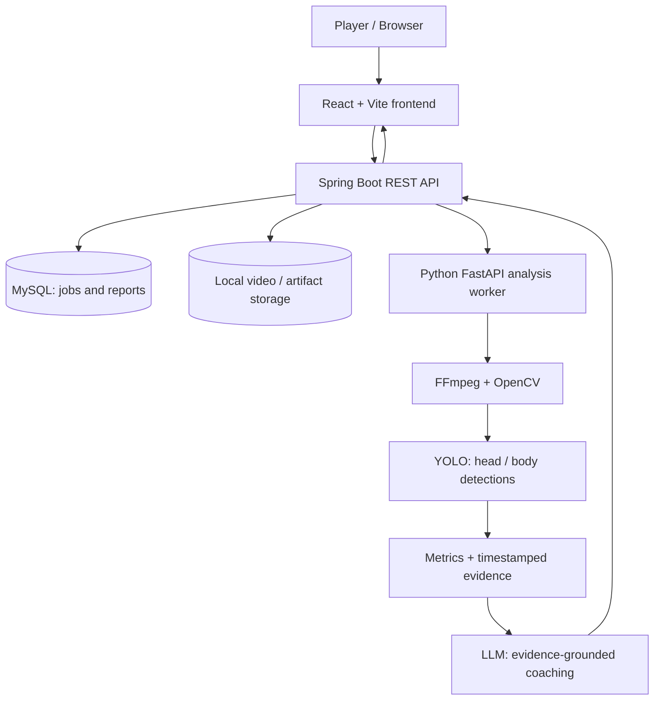

<div align="center">

# 🎯 Vanlyzer

### Upload. Analyze. Improve.

**A planned AI-powered VALORANT VOD review web app that turns gameplay recordings into visual, actionable coaching.**


[What is Vanlyzer?](#-what-is-vanlyzer) · [Quick start](#-quick-start-for-new-contributors) · [Architecture](#-architecture) · [Roadmap](#-30-day-roadmap) · [FAQ](#-faq)

</div>

> [!IMPORTANT]
> **Project status:** This README describes the **planned MVP architecture**. The full application and its analysis pipeline have **not been verified as implemented**. Setup commands below describe the expected layout **after the team scaffolds the services**. Do not mistake the example reports for actual model results.

## 🧠 What is Vanlyzer?

Vanlyzer is a **post-match VALORANT gameplay analysis platform**. A player uploads a recorded gameplay clip; Vanlyzer processes the video, detects selected visual events, measures aim-related patterns, and produces an AI-assisted summary with **timestamped, annotated visual evidence**.

The player should be able to click a mistake and jump to the exact moment in the video.

### ❓ The problem

Players often know **that** they lost a gunfight but not **why**. Raw match statistics rarely show crosshair alignment, the moment a mistake happened, or a specific exercise to practice. Reviewing an entire recording manually is slow, and generic AI feedback without visual evidence can be misleading.

### ✅ Our proposed solution

| Step | Player sees | What the system does |
| --- | --- | --- |
| 1. Upload | Video upload form | Validate and store a gameplay recording |
| 2. Process | Job status | Sample frames and detect visual objects/events |
| 3. Understand | Match/clip summary | Summarize *supported* observations |
| 4. Evaluate | Mistake cards + timeline | Calculate measurable aim/crosshair signals |
| 5. Improve | Coaching suggestions | Generate recommendations grounded in evidence |
| 6. Review | Annotated frames + video | Link each observation back to its timestamp |

> [!NOTE]
> An object detector can identify objects; it **cannot by itself understand tactics or explain a lost round**. Vanlyzer will label uncertain observations and avoid inventing unsupported kills, headshot rates, or strategic mistakes.

## ✨ MVP features

- [ ] Upload a short MP4/MOV gameplay recording
- [ ] Create and track an asynchronous analysis job
- [ ] Sample timestamped frames with FFmpeg/OpenCV
- [ ] Detect enemy bodies/heads using a tested VALORANT YOLO model
- [ ] Estimate crosshair-to-head alignment when both are visible
- [ ] Generate a cautious, evidence-based clip summary
- [ ] Produce mistake cards and actionable coaching suggestions
- [ ] Show annotated frames, clickable timestamps, and simple charts
- [ ] Store past reports

**Out of scope for the first month:** live coaching, overlays, reading game memory, full tactical understanding, multi-game support, training a model from scratch, and guaranteed full-match accuracy.

<details>
<summary><strong>👀 Example analysis output (illustrative only)</strong></summary>

```json
{
  "matchId": "demo-001",
  "status": "COMPLETED",
  "summary": "In the reviewed clip, several visible engagements showed delayed crosshair alignment.",
  "events": [
    {
      "timestampSeconds": 32.4,
      "type": "CROSSHAIR_ALIGNMENT",
      "observation": "Crosshair below detected enemy head",
      "confidence": 0.87,
      "evidenceFrame": "artifacts/demo-001/frame-0032.jpg",
      "advice": "Practice holding common angles at head level."
    }
  ]
}
```

This is a **sample API contract**, not an output obtained from a real analyzed match.

</details>

## 🏗 Architecture



| Layer | Planned stack | Responsibility |
| --- | --- | --- |
| UI | React, Vite, Tailwind CSS, Recharts | Upload, video player, timeline, dashboard |
| Main API | Java, Spring Boot | Uploads, jobs, database, reports |
| Database | MySQL | Metadata, events, results |
| AI worker | Python, FastAPI | Video analysis and inference |
| Video/vision | FFmpeg, OpenCV, YOLO | Frame extraction and object detection |
| Coaching | Vision-capable LLM API | Evidence-based explanations |

**Flow:** `UPLOAD → QUEUED → PROCESSING → COMPLETED / FAILED`.

## 🧪 Model starting point

We will **test**, not blindly adopt, these community repositories:

1. [`achigo0/valorant-ai`](https://github.com/achigo0/valorant-ai) — the team's current first choice because a short-clip video demo has been tested by a teammate.
2. [`jparedesDS/valorant-object-detection`](https://github.com/jparedesDS/valorant-object-detection) — an alternative head/body detector for comparison.

**Validation gate:** Test both on the *same* small set of annotated clips. Compare missed heads, false positives, speed, and whether detections can be exported with timestamps. Check repository/model licenses before redistributing weights or using them commercially.

## 🚀 Quick start for new contributors

> [!WARNING]
> **Scaffold-dependent:** The commands below are the **intended local development workflow**, not a claim that these directories, scripts, or endpoints already exist. Once a teammate commits the project skeleton, update this section to match the actual code and lockfile versions. Until then, you can clone the repository and prepare prerequisites, but you cannot run the complete app.

### 1. Prerequisites

| Tool | Needed for | Check |
| --- | --- | --- |
| Git | Clone source | `git --version` |
| Node.js (active LTS) + npm | React frontend | `node --version` / `npm --version` |
| Java 21 + Maven wrapper | Spring Boot backend | `java -version` |
| Python 3.11+ | AI worker | `python --version` (or `python3 --version`) |
| MySQL 8 | Application database | `mysql --version` |
| FFmpeg + ffprobe | Video decoding | `ffmpeg -version` / `ffprobe -version` |

For local MVP testing, use **short gameplay clips (30–60 seconds)** and CPU inference if GPU support is unavailable.

### 2. Clone the project

```bash
git clone https://github.com/<ORG_OR_USERNAME>/vanlyzer.git
cd vanlyzer
```

Replace `<ORG_OR_USERNAME>` with your team's actual GitHub organization or username. **No Vanlyzer repository URL has been provided yet.**

### 3. Expected folder layout

```text
vanlyzer/
├── frontend/             # React + Vite
├── backend/              # Spring Boot (Maven wrapper planned)
├── ai-service/           # Python + FastAPI
│   └── models/           # Local model weights (not committed)
├── storage/              # Local videos + generated evidence (gitignored)
├── docs/
└── README.md
```

### 4. Configure environment (planned convention)

Create `.env` files from each service's **committed** `.env.example` once available; never commit secrets.

**`backend/.env` — proposed variables**

```dotenv
DB_URL=jdbc:mysql://localhost:3306/vanlyzer
DB_USERNAME=vanlyzer
DB_PASSWORD=replace_me
AI_SERVICE_URL=http://localhost:8000
STORAGE_DIR=../storage
INTERNAL_API_TOKEN=replace_with_a_long_random_secret
```

**`ai-service/.env` — proposed variables**

```dotenv
MODEL_PATH=./models/valorant.pt
SPRING_CALLBACK_URL=http://localhost:8080/internal/callback
INTERNAL_API_TOKEN=replace_with_the_same_secret
LLM_API_KEY=replace_me
```

**`frontend/.env` — proposed variables**

```dotenv
VITE_API_BASE_URL=http://localhost:8080/api
```

These are **suggested variable names**. Spring Boot and FastAPI must be explicitly configured to load them; merely creating `.env` files does not make the values available to the services. Never place model provider keys in the frontend.

### 5. Start MySQL (after configuring it)

Create a local database and restricted development account, then supply its credentials to Spring Boot:

```sql
CREATE DATABASE IF NOT EXISTS vanlyzer;
CREATE USER IF NOT EXISTS 'vanlyzer'@'localhost' IDENTIFIED BY 'replace_me';
GRANT ALL PRIVILEGES ON vanlyzer.* TO 'vanlyzer'@'localhost';
```

Use a different strong password outside throwaway local development.

### 6. Start the services (after the project skeleton exists)

**Terminal A — AI worker**

```bash
cd ai-service
python -m venv .venv
# macOS / Linux:
source .venv/bin/activate
# Windows PowerShell: .venv\Scripts\Activate.ps1
pip install -r requirements.txt
uvicorn main:app --reload --port 8000
```

*The `uvicorn main:app` command assumes `main.py` exposes a FastAPI variable named `app`.*

**Terminal B — Spring Boot**

```bash
cd backend
# macOS / Linux:
./mvnw spring-boot:run
# Windows: mvnw.cmd spring-boot:run
```

**Terminal C — React**

```bash
cd frontend
npm install
npm run dev
```

Once implemented using typical defaults, expect the UI at `http://localhost:5173`, the backend at `http://localhost:8080`, and FastAPI docs at `http://localhost:8000/docs`. Ports may differ based on the committed configuration.

### 7. First end-to-end test (acceptance criteria)

- [ ] Open the UI locally.
- [ ] Upload a short VALORANT MP4 clip.
- [ ] Observe a job change from `QUEUED` to `PROCESSING`.
- [ ] Wait for `COMPLETED` or a helpful `FAILED` message.
- [ ] Open a report with at least one evidence-backed observation.
- [ ] Click the observation timestamp to seek in the video.
- [ ] See an annotated screenshot and a practical improvement suggestion.

**A functioning report must use real detections from the uploaded file; mock data is only for UI development.**

<details>
<summary><strong>🛠 Troubleshooting</strong></summary>

| Issue | What to check |
| --- | --- |
| `ffmpeg: command not found` | Install FFmpeg and ensure it is on `PATH` |
| `ModuleNotFoundError` | Activate Python venv; install `requirements.txt` |
| Model file missing | Place approved model weights at `MODEL_PATH` |
| Database connection failed | MySQL running? Credentials, port, DB name correct? |
| Browser cannot call backend | Backend running? CORS configured for Vite origin? |
| Video upload fails | Supported codec, file size/duration limits, storage permissions |
| Processing is slow | Start with shorter clips and lower frame sampling |
| No detections | Check input resolution, model labels, confidence threshold, representative footage |
| LLM report fails | Verify server-side API key, quotas, timeouts, and fallback behavior |

</details>

## 🧩 Suggested API contract (not yet implemented)

| Method | Route | Purpose |
| --- | --- | --- |
| `POST` | `/api/matches/upload` | Upload video and create job |
| `GET` | `/api/matches` | List previous uploads |
| `GET` | `/api/matches/{id}/status` | Poll processing state |
| `GET` | `/api/matches/{id}/report` | Read summary and coaching |
| `GET` | `/api/matches/{id}/events` | Read timestamped observations |
| `POST` | `/internal/analyze` | Start worker job (private) |
| `POST` | `/internal/callback` | Receive result (private, authenticated) |

Internal endpoints must not be exposed to the public Internet without authentication.

## 👥 Three-person team

| Owner | Hardware | Primary responsibilities |
| --- | --- | --- |
| Member 1 — AI/CV | MacBook Air M4 + Lenovo Core Ultra 7 | Test models; video pipeline; evidence; metrics; LLM coaching |
| Member 2 — Backend | i5 11th-gen, Iris Xe, 16 GB | Spring Boot; MySQL; uploads; processing jobs; integration |
| Member 3 — Frontend | i7 4th-gen, Intel HD 4500 / Quadro K3100M, 16 GB | React UI; annotated evidence viewer; charts; timeline |

The older Quadro machine should **not** be a dependency for modern YOLO/CUDA workflows. Use short clips and test CPU inference as a fallback.

## 📅 30-day roadmap

<details open>
<summary><strong>Week 1 — Prove it works (Days 1–7)</strong></summary>

- [ ] **AI:** Compare both models on one 30–60 second clip; export JSON detections.
- [ ] **Backend:** Scaffold Spring Boot, MySQL, upload and job status.
- [ ] **Frontend:** Scaffold React; upload page and report mock data.
- [ ] **Team gate:** Video → frame → detection → timestamped annotation works.

</details>

<details>
<summary><strong>Week 2 — Extract useful signals (Days 8–14)</strong></summary>

- [ ] **AI:** Crosshair location; head alignment; measure false positives.
- [ ] **Backend:** Connect to Python; store event and metric results.
- [ ] **Frontend:** Video player, clickable events, initial charts.
- [ ] **Team gate:** End-to-end report from a real clip, without an LLM.

</details>

<details>
<summary><strong>Week 3 — Coaching and visual explanations (Days 15–21)</strong></summary>

- [ ] **AI:** Summaries and coaching grounded in structured events.
- [ ] **Backend:** Report endpoints, failures/retries, storage cleanup.
- [ ] **Frontend:** Annotated screenshots; mistake cards; summary page.
- [ ] **Team gate:** Video → report with one credible, timestamped mistake.

</details>

<details>
<summary><strong>Week 4 — Stabilize and demo (Days 22–30)</strong></summary>

- [ ] Test at least three unfamiliar clips.
- [ ] Reduce false positives; add confidence/uncertainty labels.
- [ ] Verify upload and job error handling.
- [ ] Polish UI and onboarding.
- [ ] Record a full end-to-end demo; document limitations.

</details>

**Fallback if detection underperforms:** Deliver timestamped annotated observations and a clearly scoped **clip** summary. Do not pretend to detect unseen tactical mistakes or produce made-up performance statistics.

## 🤝 How to contribute

1. Create an issue describing a small feature or bug.
2. Create a branch: `feature/ai-analysis`, `feature/backend`, or `feature/frontend`.
3. Commit only code and small, approved test assets; **do not commit gameplay recordings, credentials, or large model weights**.
4. Open a pull request with a screenshot or sample API payload and a short test plan.
5. Have another member review before merging.

## ❔ FAQ

<details>
<summary><strong>Does Vanlyzer analyze live gameplay?</strong></summary>

No. The MVP only analyzes videos uploaded **after** gameplay.

</details>

<details>
<summary><strong>Can I run it without an NVIDIA GPU?</strong></summary>

The planned pipeline should support CPU inference for short clips. GPU acceleration can make processing faster but should not be required to run the MVP.

</details>

<details>
<summary><strong>Will it understand every strategic mistake?</strong></summary>

No. Head/body detection and alignment metrics offer useful but limited signals. Any tactical inference must be presented carefully, with visible evidence or an uncertainty note.

</details>

<details>
<summary><strong>Is Vanlyzer affiliated with Riot Games?</strong></summary>

No. This is an independent project. Respect Riot's applicable third-party tool policies and licensing; do not read game memory or provide live unfair competitive assistance. Confirm requirements before public distribution.

</details>

<details>
<summary><strong>Where do I get the YOLO weights?</strong></summary>

Model weights are **not included** in this proposed repository structure. Evaluate the candidate repositories above, verify their licenses, and document the exact approved download/installation procedure before publishing a runnable release.

</details>

---

<div align="center">

**Vanlyzer — Improve with evidence, not guesses.**

*Built as a three-person, one-month MVP project.*

</div>
